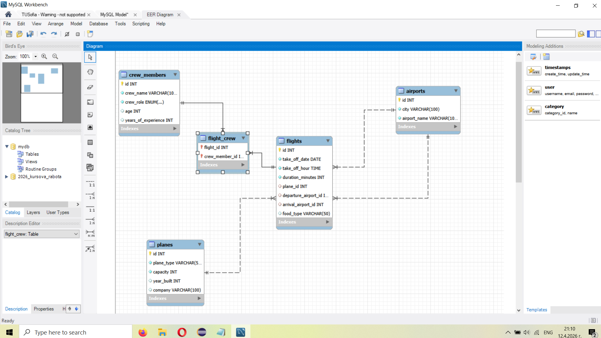

# Airport Management Database (MySQL)

This project features a fully normalized relational database designed for managing airport operations, flights, planes, and crew members. It was developed using MySQL Workbench and includes a complete schema, sample data, and complex queries.

## 🗄️ Database Architecture
The database follows relational design principles and includes 5 main tables:
* `airports`: Stores airport details and locations.
* `planes`: Tracks aircraft types, capacities, and airlines.
* `crew_members`: Maintains records of pilots, navigators, and cabin crew.
* `flights`: Central table managing flight schedules, durations, and routes.
* `flight_crew`: A junction table enabling many-to-many relationships between flights and crew.

## 🛠️ Features & Implementation
* **Data Integrity:** Enforced via Primary Keys, Foreign Keys, and `ON DELETE CASCADE` rules.
* **Complex Queries:** Includes INNER JOINs, LEFT OUTER JOINs, subqueries, and aggregate functions with `GROUP BY`.
* **Triggers:** Contains a custom trigger (`prevent_crew_overlays`) that automatically prevents double-booking a crew member on the same date.
* **Stored Procedures:** Features a cursor-based stored procedure (`PlaneUsageWhileReport`) that generates automated maintenance warnings based on total flight minutes per plane.

## 🚀 How to Use
1. Run `schema_and_data.sql` to generate the database structure and populate it with sample data.
2. Run `queries_and_routines.sql` to execute the analytical queries, create the triggers, and initialize the stored procedures.